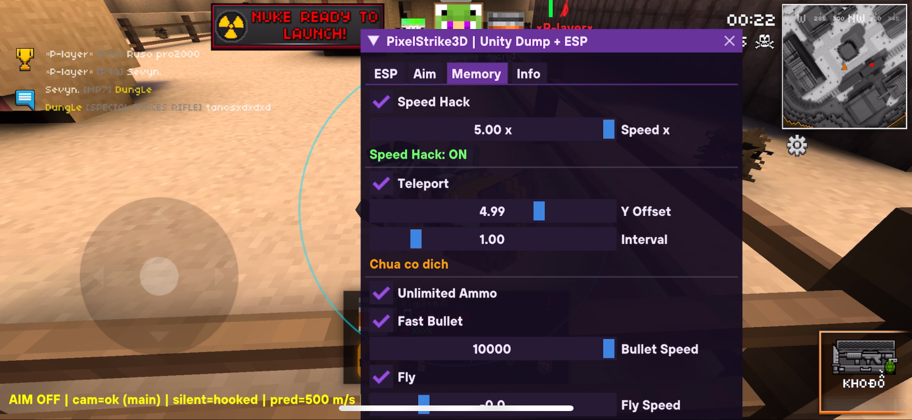

# PixelStrike3D Unity ESP - IL2CPP

iOS tweak for **PixelStrike3D** (`com.pixellabs.pixelstrike3d`) — Unity IL2CPP game. ESP overlay, skeleton mapped from the game's real bone names, VisCheck, IL2CPP metadata dumper and bone logger.


## 📸 Preview



## ⚠️ Disclaimer

This project is for **educational purposes only**. Use responsibly and at your own risk. The developers are not responsible for any consequences resulting from the use of this software.

## 📋 Features

### ESP Tab
- **ESP Line** - Lines pointing to players (Top / Center / Bottom)
- **Corner Box** - Corner boxes around players
- **ESP Skeleton** - Skeleton drawn from the real bone rig (`floor`, `body_0`, `head`, `l_arm`, `l_leg`, `Feet_Left`, …)
- **ESP Health** - PC-style vertical health bar
- **ESP Name** - Player name (compact text, no background)
- **ESP Distance** - Distance in meters under the name
- **VisCheck** - Green = visible, Red = behind wall
- **Draw All** - Show teammates as well as enemies

### Dumper / Bone Logger
- **IL2CPP Dump** - Dumps classes, fields and methods to `Documents/PixelStrike3D_dump.txt`
- **Dump Bones** - Logs the live bone transforms of enemies to `Documents/PixelStrike3D_bones.txt` (used to map the exact rig)

### Other Tabs
- **Aim** - Aimbot / Silent Aim / No Spread / Prediction settings, FOV, smooth, target bone
- **Memory** - Speed Hack, Teleport, Unlimited Ammo, Fast Bullet, Fly
- **Info** - Build info

## 🎮 Supported Game

- **PixelStrike3D** (`com.pixellabs.pixelstrike3d`)
- Unity IL2CPP based game
- Package ID: `com.pixel.strike3d`

## 📦 Requirements

- iOS 14.0+
- Jailbroken device (rootless compatible)
- Theos development environment
- PixelStrike3D installed

## 🛠️ Building

1. Install [Theos](https://theos.dev/)
2. Clone this repository:
```bash
git clone https://github.com/dungleioshax-droid/PixelStrike3D.git
cd PixelStrike3D
```

3. Build:
```bash
make package
```

4. Output: `packages/com.pixel.strike3d_1.0_iphoneos-arm64.deb` — install with your favourite package manager (Sileo/Zebra) or `make package install` (set `THEOS_DEVICE_IP` in `Makefile` first).

## ⚙️ Configuration

Edit `ESPConfig.h`:

```cpp
// Player class
#define PLAYER_CLASS_NAME "Health"
#define PLAYER_ASSEMBLY_NAME "Assembly-CSharp.dll"

// ESP max distance
#define ESP_MAX_DISTANCE 300.0f
```

## 🏗️ Project Structure

```
PixelStrike3D/
├── Esp/              # Menu / loader (ImGuiLoad, drag view)
├── IL2CPP/           # IL2CPP hooking utils, vectors, ESP hooks, Dumper
├── IMGUI/            # ImGui + IL2CPP bridge
├── Init/             # Initialization code
├── ESPConfig.h       # ESP configuration
├── ImGuiDrawView.mm  # Main ESP rendering + menu
├── Makefile          # Theos build (rootless, arm64)
├── Pixel.plist       # Bundle filter (com.pixellabs.pixelstrike3d)
└── control           # Package metadata (com.pixel.strike3d)
```

## 🙏 Credits

- **Base framework**: [IOS-ESP-AutoUpdate](https://github.com/xS3Cx/IOS-ESP-AutoUpdate) by [xS3Cx](https://github.com/xS3Cx)
- **ImGui**: [Dear ImGui](https://github.com/ocornut/imgui)
- **IL2CPP**: Unity IL2CPP runtime

## 📄 License

MIT License - see the [LICENSE](LICENSE) file for details.

---

# PixelStrike3D Unity ESP - IL2CPP (Tiếng Việt)

Tweak iOS cho game **PixelStrike3D** (`com.pixellabs.pixelstrike3d`) — game Unity IL2CPP. Vẽ ESP, skeleton theo đúng tên xương thật của game, VisCheck, dump metadata IL2CPP và log xương.

## 📸 Xem Trước


## ⚠️ Lưu Ý

Dự án chỉ dùng cho **mục đích học tập**. Tự chịu trách nhiệm khi sử dụng.

## 📋 Tính Năng

### Tab ESP
- **ESP Line** - Vẽ đường tới người chơi (Trên / Giữa / Dưới)
- **Corner Box** - Khung góc quanh người chơi
- **ESP Skeleton** - Xương vẽ từ rig thật (`floor`, `body_0`, `head`, `l_arm`, `l_leg`, `Feet_Left`, …)
- **ESP Health** - Thanh máu dọc kiểu PC
- **ESP Name** - Tên người chơi (chữ gọn, không nền)
- **ESP Distance** - Khoảng cách (mét) dưới tên
- **VisCheck** - Xanh lá = nhìn thấy, Đỏ = sau tường
- **Draw All** - Hiện cả đồng đội lẫn địch

### Dump / Log Xương
- **IL2CPP Dump** - Xuất class/field/method ra `Documents/PixelStrike3D_dump.txt`
- **Dump Bones** - Ghi transform xương thật của địch ra `Documents/PixelStrike3D_bones.txt` (dùng để map rig chính xác)

### Các Tab Khác
- **Aim** - Cài đặt Aimbot / Silent Aim / No Spread / Prediction, FOV, độ mượt, xương mục tiêu
- **Memory** - Speed Hack, Teleport, Unlimited Ammo, Fast Bullet, Fly
- **Info** - Thông tin bản build

## 🎮 Game Hỗ Trợ

- **PixelStrike3D** (`com.pixellabs.pixelstrike3d`)
- Game Unity IL2CPP
- Package ID: `com.pixel.strike3d`

## 📦 Yêu Cầu

- iOS 14.0+
- Máy đã jailbreak (tương thích rootless)
- Môi trường Theos
- Đã cài PixelStrike3D

## 🛠️ Cách Build

1. Cài [Theos](https://theos.dev/)
2. Clone repo:
```bash
git clone https://github.com/dungleioshax-droid/PixelStrike3D.git
cd PixelStrike3D
```

3. Build:
```bash
make package
```

4. File deb ra ở `packages/com.pixel.strike3d_1.0_iphoneos-arm64.deb` — cài bằng Sileo/Zebra hoặc `make package install` (cấu hình `THEOS_DEVICE_IP` trong `Makefile` trước).

## ⚙️ Cấu Hình

Sửa `ESPConfig.h`:

```cpp
// Class người chơi
#define PLAYER_CLASS_NAME "Health"
#define PLAYER_ASSEMBLY_NAME "Assembly-CSharp.dll"

// Khoảng cách ESP tối đa
#define ESP_MAX_DISTANCE 300.0f
```

## 🏗️ Cấu Trúc Dự Án

```
PixelStrike3D/
├── Esp/              # Menu / loader (ImGuiLoad, drag view)
├── IL2CPP/           # Tiện ích hook IL2CPP, vector, hook ESP, Dumper
├── IMGUI/            # ImGui + cầu nối IL2CPP
├── Init/             # Code khởi tạo
├── ESPConfig.h       # File cấu hình
├── ImGuiDrawView.mm  # Vẽ ESP chính + menu
├── Makefile          # Build Theos (rootless, arm64)
├── Pixel.plist       # Lọc bundle (com.pixellabs.pixelstrike3d)
└── control           # Metadata gói (com.pixel.strike3d)
```

## 🙏 Ghi Công

- **Framework gốc**: [IOS-ESP-AutoUpdate](https://github.com/xS3Cx/IOS-ESP-AutoUpdate) bởi [xS3Cx](https://github.com/xS3Cx)
- **ImGui**: [Dear ImGui](https://github.com/ocornut/imgui)
- **IL2CPP**: Unity IL2CPP runtime

## 📄 Giấy Phép

MIT License - xem file [LICENSE](LICENSE).
